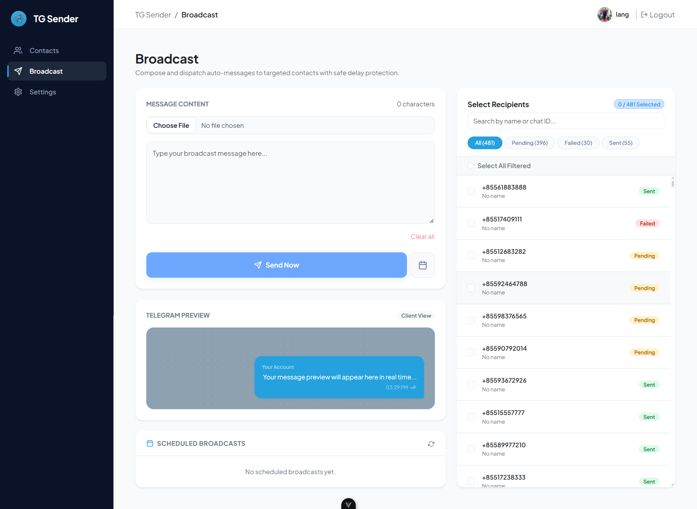

# 📱 Telegram Auto Sender — Frontend

A modern, responsive web dashboard built with **Vue 3** and **Vite** for automated Telegram bulk messaging, contact management, and schedule dispatching.

---

## 📸 Screenshots

### 1. Contacts Management Page
Manage your contact lists, import phone numbers in bulk via Excel/CSV/TXT, filter, edit, and track message deliverability status.


---

### 2. Broadcast & Scheduled Messaging Page
Compose and dispatch bulk messages with text and media attachments, configure scheduled auto-send times, and track job queues.



---

## 🚀 Key Features

- **📩 Broadcast Composer**: Send broadcast messages with text and image attachments.
- **⏰ Scheduled Messaging**: Pick a future date and time for automatic dispatching.
- **👥 Contact Management**:
  - Bulk import from Excel (`.xlsx`, `.xls`), CSV, and TXT files.
  - Add, edit, single delete, and multiple selection delete.
  - Automatic status tracking (`pending`, `sent`, `failed`).
- **🛡️ Anti-Flood / Anti-Ban**: Delays and safe pacing handled seamlessly in conjunction with backend.
- **🔐 Admin Authentication**: Secure login, profile customization, avatar uploads, and OTP password reset.

---

## 🛠️ Tech Stack

- **Framework**: [Vue 3](https://vuejs.org/) (Composition API with `<script setup>`)
- **Build Tool**: [Vite](https://vite.dev/)
- **State Management**: [Pinia](https://pinia.vuejs.org/)
- **Router**: [Vue Router 4](https://router.vuejs.org/)
- **HTTP Client**: [Axios](https://axios-http.com/)
- **Styling**: Bootstrap 5 + Custom Modern UI CSS

---

## ⚙️ Getting Started

### 1. Clone the repository
```bash
git clone https://github.com/songhai-yeanlang/telegram-auto-sender-frontend.git
cd telegram-auto-sender-frontend
```

### 2. Install dependencies
```bash
npm install
```

### 3. Configure Environment Variables
Create a `.env` file in the root directory:
```env
VITE_API_BASE_URL=http://localhost:3000/api
# Or production URL:
# VITE_API_BASE_URL=https://your-backend-api.domain.com/api
```

### 4. Run Development Server
```bash
npm run dev
```

### 5. Build for Production
```bash
npm run build
```

---

## 📄 License
This project is open-source and available under the [MIT License](LICENSE).
